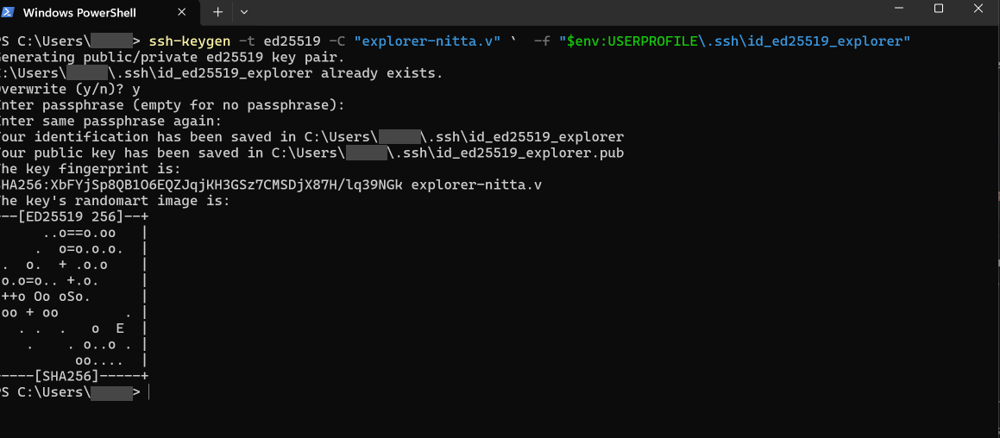
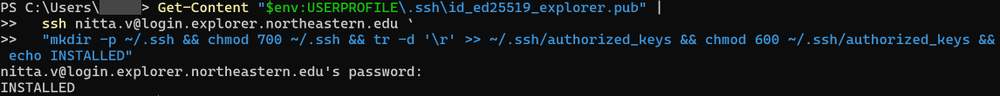
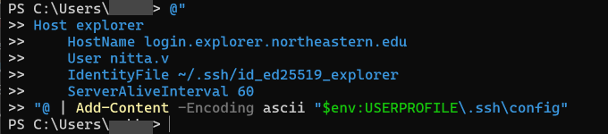

# Explorer HPC Runbook

How to get onto NEU's Explorer cluster, run GPU jobs, watch them, and (optionally) let an AI coding
agent drive the whole thing for you.

**Who this is for:** anyone with an Explorer account who hasn't used SSH keys or
Slurm before. Works on **Windows** and **macOS/Linux** — both are covered side by side.

**Time:** about 15 minutes for first-time setup. You type your NEU password exactly once.

---

## 0. Before you start

You need:

- An **Explorer account**. Request at [rc.northeastern.edu](https://rc.northeastern.edu) if you
  don't have one. Your username is usually your NEU email prefix (e.g. `j.doe`).
- Membership in the Slurm account **`<SLURM_ACCOUNT>`** . Ask whoever administers your allocation. Without it,
  `sbatch` will reject your jobs.
- A terminal: **PowerShell** on Windows, **Terminal** on macOS.

Everything below assumes you replace `<USER>` with your own Explorer username. That is the part
of your email **before** the `@` — `j.doe`, not `j.doe@northeastern.edu`. With the full email,
`ssh` tries to log in as the wrong user. Replace the angle brackets too: `j.doe`, not `<j.doe>`.

Where `<USER>` appears, and whether it has to be exact (examples for user `j.doe`):

| Where | Must be your real username? | Example |
|---|---|---|
| §1a, the key label `-C "explorer-<USER>"` | **No** — just a label, any text works | `-C "explorer-j.doe"`, or `-C "explorer-laptop"` |
| §1b, §1d, §5, §6, `<USER>@login.explorer.northeastern.edu` | **Yes**, exactly | `ssh j.doe@login.explorer.northeastern.edu` |
| §1c, `User <USER>` in `~/.ssh/config` | **Yes**, exactly | `User j.doe` |
| §5a, `"user"` in `connector_config.json` | **Yes**, exactly | `"user": "j.doe"` |
| §2, `/home/<USER>`, `/scratch/<USER>` | It is your username; on the cluster `$USER` fills it in for you | `/scratch/j.doe` |

### What is Explorer, in one paragraph

Explorer is a shared Linux cluster. You log in to a **login node** (`explorer-01`), which is a
normal shared machine with **no GPU**. You don't run work there. Instead you submit a **job** to
**Slurm**, the scheduler, which finds you a **compute node** with the GPUs you asked for, runs your
script there, and writes the output to a file. You then read that file. The whole workflow is
asynchronous: submit, wait, read.

---

## 1. One-time setup: SSH keys

### Why bother, instead of just typing your password?

Three reasons, and the third is the real one:

1. You stop typing your password dozens of times a day.
2. Scripts and tools can connect without a human present.
3. **Your NEU password is your entire identity** — email, Canvas, everything. An SSH key is a
   separate credential that only opens a shell on Explorer, and you can revoke it in ten seconds
   without changing your password.

> **Never put your NEU password in a file, script, or `.env`.** Besides being unsafe, it won't
> work — OpenSSH deliberately refuses to read passwords from anywhere but a terminal.

### 1a. Generate the key

<table>
<tr><th>Windows (PowerShell)</th><th>macOS / Linux</th></tr>
<tr><td>

```powershell
ssh-keygen -t ed25519 -C "explorer-<USER>" `
  -f "$env:USERPROFILE\.ssh\id_ed25519_explorer"
```

</td><td>

```bash
ssh-keygen -t ed25519 -C "explorer-<USER>" \
  -f ~/.ssh/id_ed25519_explorer
```

</td></tr>
</table>

Example for user `j.doe` (Windows; the text after `-C` is only a label, so any name works):

```powershell
ssh-keygen -t ed25519 -C "explorer-j.doe" `
  -f "$env:USERPROFILE\.ssh\id_ed25519_explorer"
```

**When prompted for a passphrase, press Enter twice** (leaving it empty). See
[§7 Security](#7-security-and-revocation) for when you'd want one instead.

What the flags mean:

| Flag | Meaning |
|---|---|
| `-t ed25519` | Key algorithm. Modern, short, fast. |
| `-C "..."` | A **comment** — just a label. It has no effect on authentication; it's how you'll recognise the key later when revoking it. |
| `-f <path>` | Where to write it. A custom name keeps this key separate from any GitHub key you may add later. |

What a successful run looks like, for a real user `nitta.v` on Windows (only the Windows folder
name is greyed out). You will see your own username, fingerprint and picture. The
`Overwrite (y/n)?` line only appears if you already had a key with this name:



This creates **two** files:

- `id_ed25519_explorer` — the **private** key. Never leaves your machine. Never paste it anywhere.
- `id_ed25519_explorer.pub` — the **public** key. Safe to share; this is what goes on the cluster.

### 1b. Install the public key on Explorer

**This is the step that asks for your NEU password — the only time.**

<table>
<tr><th>Windows (PowerShell)</th><th>macOS / Linux</th></tr>
<tr><td>

```powershell
Get-Content "$env:USERPROFILE\.ssh\id_ed25519_explorer.pub" |
  ssh <USER>@login.explorer.northeastern.edu `
  "mkdir -p ~/.ssh && chmod 700 ~/.ssh && tr -d '\r' >> ~/.ssh/authorized_keys && chmod 600 ~/.ssh/authorized_keys && echo INSTALLED"
```

</td><td>

```bash
ssh-copy-id -i ~/.ssh/id_ed25519_explorer.pub \
  <USER>@login.explorer.northeastern.edu
```

</td></tr>
</table>

Example for user `j.doe` (Windows). Here the username **must** be exact:

```powershell
Get-Content "$env:USERPROFILE\.ssh\id_ed25519_explorer.pub" |
  ssh j.doe@login.explorer.northeastern.edu `
  "mkdir -p ~/.ssh && chmod 700 ~/.ssh && tr -d '\r' >> ~/.ssh/authorized_keys && chmod 600 ~/.ssh/authorized_keys && echo INSTALLED"
```

It should print `INSTALLED` after you type your NEU password (here for user `nitta.v`; type
your own username where it says `nitta.v`):



If you get `kex_exchange_identification: read: Connection reset` instead, the server dropped the
connection before asking for a password. This often follows several failed password attempts in a
short time; wait a few minutes and try again. See §6.

> **Windows users:** that `tr -d '\r'` is not decoration. Windows ends lines with CRLF; a stray
> carriage return inside `authorized_keys` silently breaks the key and the error message gives you
> no hint why. Do not omit it.
>
> **Mac users:** if `ssh-copy-id` is missing, use the Windows-style pipe command above (without the
> backticks, and you can drop the `tr`).

**Verify the host fingerprint** when prompted. Explorer's keys, as of 2026-10-03:

| Type | SHA256 fingerprint |
|---|---|
| ED25519 | `PxoJM2iNOhJ/UdghVgDaa+kx+/WrZ9aZmSjgV1+MSyA` |
| ECDSA | `sWIYxkFL5wsZhmBIndWQehsvG5CdOHtgEeVB2vciRAc` |
| RSA | `FzD4Zbq3kSZ98jdoLSoKlIgIla52rSyVfve0adPpxJQ` |

> PuTTY users: you'll be asked to accept the host key **again** even if PuTTY already trusts it.
> PuTTY caches host keys in the Windows registry; OpenSSH uses `~/.ssh/known_hosts`. Different
> systems, different trust stores. This is expected.

### 1c. Make it convenient (optional but recommended)

This step creates a **file** called `~/.ssh/config` (Windows: `C:\Users\<you>\.ssh\config`, no
extension). The block below is that file's contents. **It is not a command — do not paste it into
your terminal.** PowerShell will try to run each line and print a screen of red errors (`Get-Host`,
`sethostname`, `The term 'User' is not recognized`). Nothing is harmed, but no file is created.

```sshconfig
Host explorer
    HostName login.explorer.northeastern.edu
    User <USER>
    IdentityFile ~/.ssh/id_ed25519_explorer
    ServerAliveInterval 60
```

To create it, use **one** of these:

<table>
<tr><th>Windows (PowerShell)</th><th>macOS / Linux</th></tr>
<tr><td>

```powershell
@"
Host explorer
    HostName login.explorer.northeastern.edu
    User <USER>
    IdentityFile ~/.ssh/id_ed25519_explorer
    ServerAliveInterval 60
"@ | Add-Content -Encoding ascii "$env:USERPROFILE\.ssh\config"
```

</td><td>

```bash
cat >> ~/.ssh/config <<'EOF'
Host explorer
    HostName login.explorer.northeastern.edu
    User <USER>
    IdentityFile ~/.ssh/id_ed25519_explorer
    ServerAliveInterval 60
EOF
```

</td></tr>
</table>

Replace `<USER>` in the `User` line before you paste: for user `j.doe` that line reads
`    User j.doe`. Everything else stays exactly as written.

Both **append**, so an existing config is kept. Paste the whole block at once, including the first
and last lines. Or by hand: `notepad "$env:USERPROFILE\.ssh\config"` (Windows; in the Save dialog
set **Save as type: All Files** so Notepad does not add `.txt`), or `nano ~/.ssh/config`.

What it looks like on Windows for user `nitta.v` — note `User nitta.v`, with no angle brackets.
Pasting prints nothing back; that is success:



Check it: `Get-Content "$env:USERPROFILE\.ssh\config"` (Windows) or `cat ~/.ssh/config`.

> **There must be exactly one `Host explorer` block.** `ssh` uses the **first** one it finds and
> ignores the rest. If an earlier attempt left a block with the literal text `User <USER>`, or a
> wrong username, the corrected block you add below it is never read — and `ssh explorer` asks
> for `<USER>@login.explorer.northeastern.edu's password`. If `Get-Content` shows more than one
> `Host explorer` block, open the file in Notepad, delete all but the correct one, and save.

macOS/Linux users can add two more lines that Windows does **not** support — they reuse one
connection for every subsequent command, which is noticeably faster:

```sshconfig
    ControlMaster auto
    ControlPath ~/.ssh/cm-%r@%h:%p
    ControlPersist 4h
```

Now `ssh explorer` is all you need.

### 1d. Verify

```bash
ssh explorer hostname
```

**Expected: `explorer-01`, `explorer-02` or similar, printed instantly, with no password prompt.**
`login.explorer.northeastern.edu` hands you to whichever login node is free, so the number can
change between connections — any of them is a pass. They share your home directory and keys. The
silence is the whole point. If it still asks for a password, see [§6 Troubleshooting](#6-troubleshooting).

---

## 2. Orientation: what's where

### Storage

| Path | What it is | Size | Use it for |
|---|---|---|---|
| `/home/<USER>` | Your home. Network (VAST), shared with Discovery. | 255 T total | Code, scripts, small results |
| `/scratch/<USER>` | Large scratch. **87% full cluster-wide.** | 1.5 P total | Big intermediates |
| `/tmp` | **Node-local**, not shared | ~337 G | Per-job temp files |
| `/dev/shm` | RAM disk, node-local | ~94–126 G | Very hot temp data |

> **There is no `/work` volume on Explorer.** If you've used other clusters, this will trip you up.
>
> **Check your quota before downloading model weights.** Volumes filling mid-download has already
> destroyed one working environment on this project.

### Partitions (where jobs run)

| Partition | Max walltime | Notes |
|---|---|---|
| `gpu` | 8 hours | Main GPU partition, 25 nodes |
| `gpu-short` | 2 hours | Same nodes, faster to schedule |
| `gpu-interactive` | 2 hours | For `--pty` interactive sessions |
| `courses-gpu` | 24 hours | Course allocation, older GPUs (P100/V100) |
| `short` | 2 days | CPU only (this is the **default** — easy to land on by accident) |

### GPUs available in `gpu`

| GPU | VRAM | Compute capability | Per node |
|---|---|---|---|
| **H200** | 141 GB | 9.0 | 8 (×4 nodes) |
| **A100** | 40/80 GB | 8.0 | 3–4 |
| V100-SXM2 | 32 GB | **7.0** | 1–8 |
| T4 | 16 GB | 7.5 | 4 |

> **Important: V100 and T4 (compute capability < 8.0) have no bfloat16 support** and no
> Flash-Attention kernels. Many modern models default to bf16. If yours does, request an A100 or
> H200 **explicitly** — otherwise `--gres=gpu:1` may land you on a V100 and fail *deep inside a
> running job* rather than at submit time:
>
> ```bash
> --gres=gpu:a100:1     # or
> --gres=gpu:h200:1
> ```

### Limits that will bite you

| QOS | Max GPUs at once | Max jobs **submitted** |
|---|---|---|
| `gpu` | 4 | **8** |
| `gpu-short` | 2 | 8 |
| `gpu-interactive` | — (2 h wall) | 4 |

**The 8-submitted-job ceiling is the real constraint.** You cannot queue 95 runs. Use throttled job
arrays — `--array=0-18%4` runs 19 tasks but never more than 4 at a time.

---

## 3. Running your first GPU job

### Step 1 — write a job script

```bash
mkdir -p ~/hpcjobs/{jobs,logs}
nano ~/hpcjobs/jobs/hello_gpu.sbatch
```

```bash
#!/bin/bash
#SBATCH --job-name=hello-gpu
#SBATCH --partition=gpu-short
#SBATCH --gres=gpu:1
#SBATCH --account=<SLURM_ACCOUNT>
#SBATCH --time=00:10:00
#SBATCH --cpus-per-task=4
#SBATCH --mem=16G
#SBATCH --output=%x_%j.out      # %x = job name, %j = job ID

echo "Running on $(hostname) with GPU $CUDA_VISIBLE_DEVICES"
nvidia-smi
```

Every `#SBATCH` line is a resource request, read by Slurm before your script runs. They must appear
**before** the first real command.

### Step 2 — submit

```bash
cd ~/hpcjobs
sbatch jobs/hello_gpu.sbatch
# -> Submitted batch job 10788632
```

**Write that job ID down.** It's how you find the job later, from any machine, in any session.

### Step 3 — watch the queue

```bash
squeue -u $USER
```

| `ST` | Meaning |
|---|---|
| `PD` | Pending — waiting for resources. `(Priority)` or `(Resources)` is normal. |
| `R` | Running |
| *(absent)* | Finished — look at the log file |

Small `gpu-short` jobs typically start in under a minute. Multi-hour, multi-GPU requests queue
much longer.

### Step 4 — read the output

```bash
cat ~/hpcjobs/hello-gpu_<JOBID>.out
```

### Step 5 — check what it actually used

```bash
sacct -j 10788632 --format=JobID,State,Elapsed,TotalCPU,MaxRSS,ReqTRES%40
```

`MaxRSS` tells you peak memory — use it to right-size `--mem` on the next run. `sacct` works long
after the job is gone; `squeue` only shows live jobs.

### Cancelling

```bash
scancel 10788632          # one job
scancel -u $USER          # all of yours
```

---

## 4. Watching what's happening

**There is no `nvtop` or `htop` on the PATH.** `htop` is available as a module; `nvtop`, `nvitop`
and `gpustat` are not installed at all. Here's what works instead.

### 4a. Attach to a running job — the closest thing to `nvtop`

While a job is running, open a **second** shell inside its allocation:

```bash
srun --jobid=<JOBID> --overlap --pty bash
nvidia-smi -l 2               # refresh every 2 seconds
module load htop && htop      # CPU / RAM side
```

`--overlap` is what makes this work — without it, Slurm refuses to start a second step in a busy
allocation.

### 4b. Follow the log live

```bash
tail -f ~/hpcjobs/hello-gpu_<JOBID>.out
```

Press `Ctrl-C` to stop following (this does **not** affect the job).

### 4c. Interactive session — develop with a GPU in front of you

```bash
srun --partition=gpu-interactive --gres=gpu:a100:1 --account=<SLURM_ACCOUNT> \
     --time=02:00:00 --cpus-per-task=8 --mem=64G --pty bash
```

You get a shell **on a GPU node**. Run things by hand, watch them live. Capped at 2 hours.

> Run this inside `tmux` or `screen` on the login node, or closing your laptop kills the session:
> ```bash
> tmux new -s dev      # later: tmux attach -t dev
> ```

### 4d. Make long jobs report on themselves — the one that matters

For multi-hour jobs you can't sit and watch. Bake telemetry into the script so it logs its own
state. See [`telemetry_demo.sbatch`](telemetry_demo.sbatch) for a working example; the core is:

```bash
# GPU sampler, every 2s, CSV so it's machine-readable later
nvidia-smi --query-gpu=timestamp,index,utilization.gpu,memory.used,temperature.gpu,power.draw \
           --format=csv,nounits -l 2 > logs/telemetry_${SLURM_JOB_ID}.csv &
SMI_PID=$!

# ... your real work here, printing PROGRESS lines ...

kill $SMI_PID
```

Two things make this worth doing properly:

- **CSV, not pretty-printed.** The same file later feeds cost and utilisation analysis instead of
  being a throwaway display.
- **Add a heartbeat loop** alongside it. A GPU-utilisation sampler can't distinguish "hung" from
  "running but CPU-bound" — both read 0%. A heartbeat printing a timestamp every 10 s can.

---

## 5. Letting an AI agent drive (optional)

Once key auth works, a local AI coding agent (Claude Code, etc.) can run the whole loop for you:
write the script, `sbatch`, poll, read the log, fix, resubmit.

**Run the agent on your laptop, not on the cluster.** Both work technically — Explorer's compute
nodes do have internet egress — but local is better because:

- The loop is asynchronous anyway; latency is dominated by queue wait, not by where the agent sits.
- Jobs outlive agent sessions. Keep state in Slurm and on disk, never in a chat session.
- A long-lived process on a shared login node is poor citizenship and may be killed by admins.

**Requirement:** the agent must be able to SSH non-interactively. Explorer makes this possible
because its SSH server offers `publickey` **without `keyboard-interactive`** — meaning **no Duo 2FA
on SSH**. (If Duo were enforced, Windows users would be stuck: Windows OpenSSH has no
`ControlMaster` support to amortise one login across many commands. Mac users could use
`ControlMaster`.)

**The key must be on the machine where the agent runs.** If the agent runs in a GitHub Codespace,
a dev container, WSL or a remote VM, that is a separate machine: it cannot see the `.ssh` folder
on your laptop. Repeat §1a–1b **in a terminal inside it** (the prompt shows a Linux path such as
`/workspaces/...`, not `PS C:\>`), then check with
`ssh -i ~/.ssh/id_ed25519_explorer <USER>@login.explorer.northeastern.edu hostname`. Run these
yourself, not through the agent — `ssh-copy-id` asks for your NEU password. A Codespace that is
deleted or rebuilt loses the key; repeat the steps.

**Golden rule:** write every job ID to a file at submission time.

```bash
JID=$(sbatch --parsable jobs/myjob.sbatch)
echo "$JID" >> ~/hpcjobs/logs/submitted_jobs.txt
```

Then any later session recovers everything with `sacct -j <ID>`. Nothing is lost when a session
ends mid-queue-wait.

---

## 5a. The Python connector (easier than raw `sbatch`)

`connector.py` wraps everything above. It needs only `ssh` on your PATH and Python 3.9+ —
no pip installs.

```bash
cp connector_config.example.json connector_config.json   # then fill in "user" and "account"
python connector.py check      # verifies config + connectivity
```

| Command | Does |
|---|---|
| `check` | Validates `connector_config.json`, confirms key auth, creates remote dirs |
| `preflight` | Runs the login-node survey remotely |
| `submit <script>` | Strips CRLF, stages the script, `sbatch`es it, records the job ID |
| `status` | Queue plus today's finished jobs |
| `watch <id>` | Polls until the job leaves the queue, then prints accounting |
| `logs <id>` | Prints the job's stdout (`--tail N` for the end only) |
| `fetch <id>` | Copies log + telemetry into `fetched/` |
| `cancel <id>` | Stops the job |
| `ledger` | GPU-hours, cumulative, **in completion order** |

```bash
python connector.py submit probe_gpu.sbatch --label "first test"
python connector.py watch 10790843
python connector.py ledger
```

Flags override `connector_config.json` per invocation: `--partition gpu --gres gpu:a100:1 --time 04:00:00`,
and `--array 0-18%4` for a throttled sweep.

**Why `ledger` sorts by completion and not by score:** charging compute in score order implies
you knew which runs would succeed before paying for them, which makes any cost curve
retrospectively optimistic. Completion order is what actually happened.

**Nothing lives in process memory.** Job IDs are appended to `jobs.jsonl` at submit time, so if
your laptop sleeps or a session ends mid-queue, a later run recovers everything from `sacct`.


---

## 6. Troubleshooting

| Symptom | Cause | Fix |
|---|---|---|
| Still prompts for password | Key not installed, or wrong permissions | Run §1b again. Check: `ssh <USER>@host "ls -ld ~ ~/.ssh ~/.ssh/authorized_keys"` — you need `700` on `~/.ssh` and `600` on `authorized_keys`; `sshd` silently refuses anything looser |
| `authorized_keys` is 1 byte | The key text came through empty | Use the **pipe** form in §1b, not a shell variable |
| Key looks right but is rejected | Windows CRLF line endings | `ssh <USER>@host "tr -d '\r' < ~/.ssh/authorized_keys > /tmp/ak && mv /tmp/ak ~/.ssh/authorized_keys && chmod 600 ~/.ssh/authorized_keys"` |
| `ssh explorer` asks for `<USER>@login...'s password` (literal `<USER>`), or for the wrong username | `~/.ssh/config` has more than one `Host explorer` block, and the first one is a stale copy. `ssh` reads only the first | Keep exactly one block with your real username — see the note at the end of §1c |
| `kex_exchange_identification: read: Connection reset` / `Connection reset by ... port 22` | The server closed the connection before authentication. Commonly follows a burst of failed password attempts | Wait a few minutes and retry. Test with `ssh -v <USER>@login.explorer.northeastern.edu hostname`. If it persists, contact Research Computing |
| `Could not resolve hostname explorer: No such host is known` | `~/.ssh/config` was never created — usually because §1c's block was pasted into the terminal instead of saved as a file | Redo §1c with the create-file command, then `ssh explorer hostname` |
| Red `Get-Host` / `sethostname` / `The term 'User' is not recognized` errors | §1c's block was pasted into PowerShell | Harmless. Redo §1c with the create-file command |
| `connector.py check`: `SSH key not found` | The key is not on the machine running the connector (e.g. the agent runs in a Codespace or container) | Repeat §1a–1b inside that machine — see §5 |
| Diagnose auth in detail | — | `ssh -v -o BatchMode=yes -o PreferredAuthentications=publickey explorer hostname` — look for `Offering public key` followed by rejection |
| `sbatch: error: Batch script contains DOS line breaks` | A Windows-authored script reached the cluster with CRLF | `connector.py submit` strips this automatically. By hand: `tr -d '
' < script > script.unix` |
| Job stuck `PD` with `(AssocMaxJobsLimit)` | Hit the 8-job ceiling | Throttle your array: `--array=0-18%4` |
| Job stuck `PD` with `(QOSMaxGRESPerUser)` | Asked for more GPUs than QOS allows | Max 4 on `gpu`, 2 on `gpu-short` |
| `Invalid account` | Missing `--account` | Add `--account=<SLURM_ACCOUNT>` |
| Job landed on CPU node | Forgot `--partition` | Default is `short` (CPU only). Always specify. |
| `nvidia-smi: command not found` | You're on the login node | Login nodes have no GPU. Use `sbatch` or `srun --pty`. |
| CUDA / bf16 errors at runtime | Landed on a V100 (sm_70) | Request `--gres=gpu:a100:1` or `gpu:h200:1` |
| Disk quota exceeded mid-download | Home filled up | Redirect caches: `export HF_HOME=/scratch/$USER/hf`, `PIP_CACHE_DIR`, `TORCH_HOME` |
| Session died, lost the job | — | Nothing is lost. `sacct -u $USER -S today` lists everything. |

---

## 7. Security and revocation

**Never commit private keys.** Add to `.gitignore`:

```gitignore
*.pem
id_ed25519*
!id_ed25519*.pub
```

**To revoke a key** — instant, and it does not touch your password:

```bash
ssh explorer
nano ~/.ssh/authorized_keys     # delete the line ending in your comment, e.g. "explorer-j.doe"
```

**About the empty passphrase.** This runbook recommends no passphrase, because unattended tools
can't type one. The tradeoff: anyone who can read your private key file gets shell on Explorer
until you revoke it. On a laptop only you use, that's reasonable — and it's still safer than typing
your NEU password, whose blast radius is your whole identity.

To add a passphrase later **without regenerating anything**:

```bash
ssh-keygen -p -f ~/.ssh/id_ed25519_explorer
```

Then cache it so tools still work unattended:

```bash
# macOS
ssh-add --apple-use-keychain ~/.ssh/id_ed25519_explorer

# Windows (PowerShell as Administrator, once)
Get-Service ssh-agent | Set-Service -StartupType Automatic
Start-Service ssh-agent
ssh-add "$env:USERPROFILE\.ssh\id_ed25519_explorer"
```

---

## 8. Quick reference

```bash
ssh explorer                                  # log in
sbatch jobs/myjob.sbatch                      # submit
sbatch --parsable jobs/myjob.sbatch           # submit, print only the ID
squeue -u $USER                               # what's running/pending
squeue --start -j <JOBID>                     # estimated start time
sacct -j <JOBID> --format=JobID,State,Elapsed,MaxRSS
sacct -u $USER -S today                       # everything today
scancel <JOBID>                               # cancel
sinfo -p gpu -o "%12G %6t %6D"                # what GPUs are free
srun --jobid=<JOBID> --overlap --pty bash     # attach to a running job
tail -f logs/myjob_<JOBID>.out                # follow output
module avail                                  # what software exists
```

### Scripts in this directory

| File | Purpose |
|---|---|
| [`connector.py`](connector.py) | The CLI. Parses arguments, picks a runner, prints results — knows nothing about Slurm. |
| [`runners/`](runners/) | One module per compute target. `hpc.py` is implemented; `runpod.py` and `aws.py` are stubs. All the behaviour lives here. |
| [`connector_config.example.json`](connector_config.example.json) | Copy to `connector_config.json` and fill in. Host, user, key path, account, partition, cache locations. **`connector_config.json` is gitignored.** |
| [`preflight_login.sh`](preflight_login.sh) | Surveys the login node: partitions, QOS limits, storage, egress, toolchain. Read-only. |
| [`probe_gpu.sbatch`](probe_gpu.sbatch) | Minimal GPU job: `nvidia-smi`, compute-node egress, storage, bf16 capability check. |
| [`telemetry_demo.sbatch`](telemetry_demo.sbatch) | Skeleton for long jobs that report on themselves. Copy and replace the WORKLOAD block. |

```bash
ssh explorer 'bash -s' < hpc/preflight_login.sh     # run the survey from your laptop
```

---

*Verified against Explorer on 2026-10-03: Rocky Linux 9.7, Slurm 23.11.6, driver 545.23.08,
CUDA 12.3, Apptainer 1.4.5. Partition and QOS limits change — re-run `preflight_login.sh` if
something here doesn't match.*
